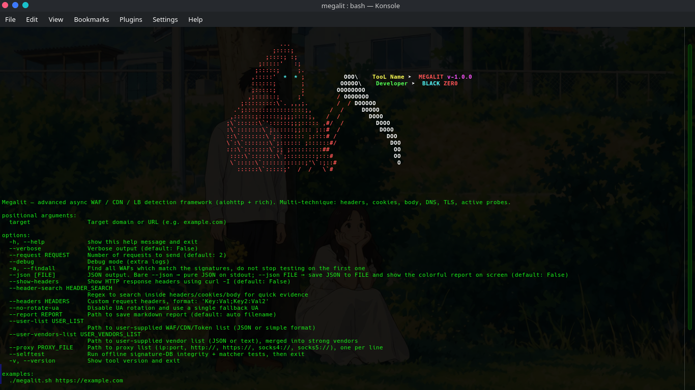
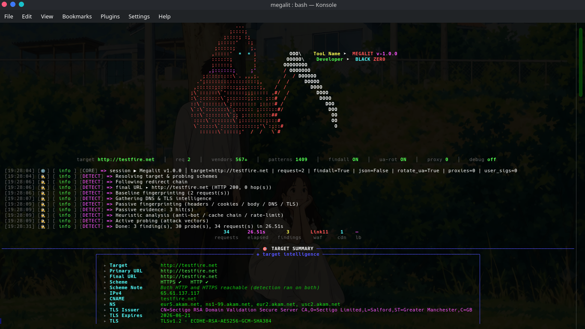
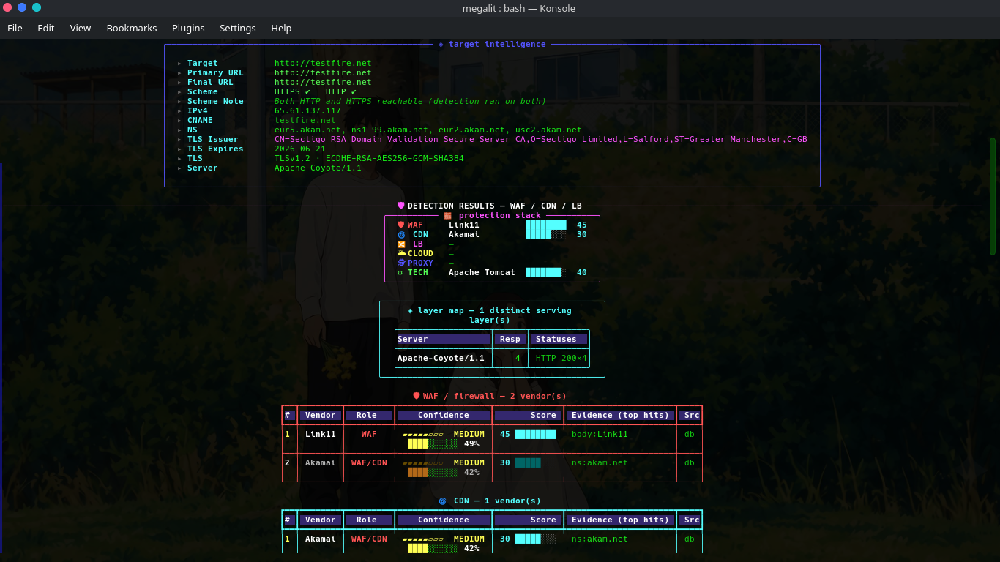
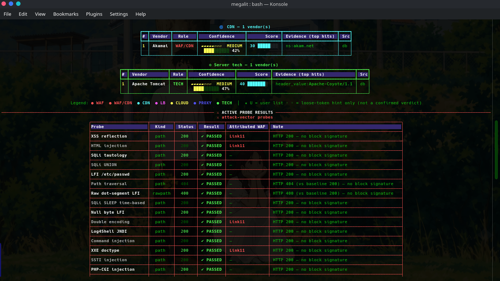
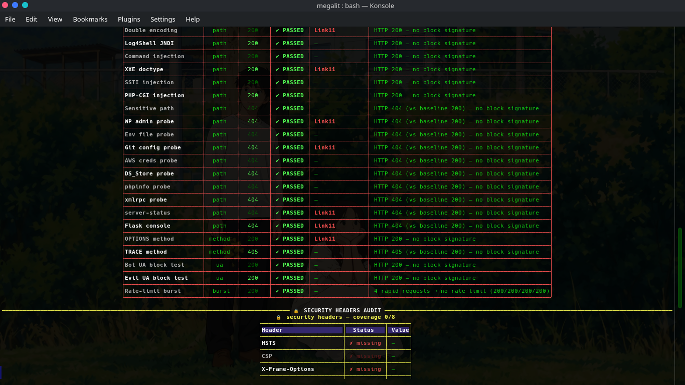
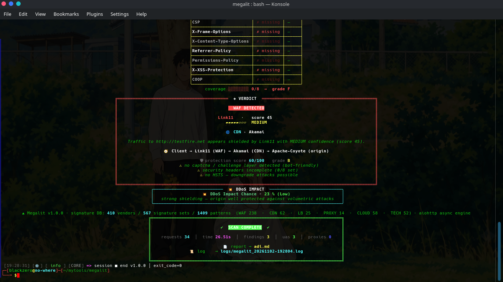

<p align="center">
  
</p>
<p align="center">
  Inspect • Test • Analyze  
  <br>
</p>
<p align="center">
  
     
 
   

  
  
</p>


**Advanced async WAF / CDN / Load-Balancer fingerprinting framework** — built with
`aiohttp` (async core) + `rich` (full colorful terminal UI).

**Megalit** identifies every protection/intermediary layer in front of a website:
**WAF, CDN, Load Balancer, Cloud platform, Proxy, Server/Framework (TECH)** —
using multi-technique fingerprinting against a **365-vendor / 1298-pattern
signature database**, a behavioural **heuristics
engine** (anti-bot, cache chain, rate-limit, exposure scoring, DDoS-impact
estimation) and **28 active attack probes** — and renders everything as
beautiful, fully center-aligned rich tables/panels.


---

## ✨ Features

| | |
|---|---|
| 🧠 **Multi-technique detection** | HTTP headers, cookies, body signatures, DNS (A/CNAME/NS/PTR), TLS certificate issuer + TLS version/cipher/ALPN, IP-range intelligence |
| 🕵 **Heuristics engine** | anti-bot & captcha intel (Turnstile / hCaptcha / reCAPTCHA / DataDome / GeeTest / queue systems…), cache-chain reconstruction from cache headers, rate-limit signal harvesting (`x-ratelimit-*`, `retry-after`), **0–100 protection score with grade + hardening advice** |
| 💥 **DDoS impact chance** *(new in v3.1)* | fireeye-style estimation of the chance a volumetric attack reaches the origin — computed from detected layers (WAF/CDN/LB/cloud), strong DDoS vendors and security headers, rendered as a centered panel + JSON + Markdown |
| ⚡ **Async engine** | `aiohttp` — redirect-chain following, retries, keep-alive |
| 🎨 **Banner collection + centered UI** | 10-banner FIRE EYE art collection (renamed MEGALIT) — a random banner every run, also shown in `--help`; terminal title `(@)==[MEGALIT]==(@)`; `Align.center` everywhere; scan-overview dashboard strip, 🧱 protection-stack panel, 🧭 traffic-flow line, styled tables, redirect tree, big verdict panel |
| 📝 **Unified log format** | every log line follows ` [time] [emoji] [ level ] [METHOD] => message` — one extra leading space, bracketed time, a subsystem emoji (🌐 HTTP · 🕵 DETECT · 🚀 PROBE · 🛰 DNS · 🧩 SIG · 🧠 HEUR · 📄 REPORT · ⚙ CORE, with ⚠/🛑/💥 overrides), 6-char lowercase level cell and colored METHOD tag; rotating file log (always TRACE) |
| 🔎 **Log visibility ladder** | default console → INFO (clean phase milestones only — **zero debug noise**), `--verbose` → DEBUG flow (requests, hops, per-probe lines), `--debug` → TRACE raw dumps (headers, internals) |
| 🧘 **No spinner UI** | phases print as plain one-line log milestones — no spinner/animation flicker in terminals |
| 📊 **Separated category tables** | every table draws a line between rows (`show_lines=True` — each row/cell visually separate) and findings render as **one table per category**: 🛡 WAF · 🌀 CDN · 🔀 LB · 🕵 PROXY · 🌥 CLOUD · ⚙ TECH (a WAF/CDN vendor appears in both) |
| 🌐 **HTTP & HTTPS** | explicit-scheme support, automatic HTTPS→HTTP fallback, alt-scheme cross-check — plain-HTTP sites are detected correctly |
| 🔫 **Active probes** | **28 attack vectors** in 4 kinds *(path / method / ua / burst)*: XSS, SQLi (tautology+UNION), LFI (+null-byte, double-encode), traversal, Log4Shell, XXE, SSTI, cmd-injection, sensitive paths (`.env` / `.git` / `.aws` / `wp-admin` / `xmlrpc` / `server-status`…), OPTIONS/TRACE method tests, bot-UA block tests, and a **rapid-burst rate-limit probe** — with block classification + WAF attribution |
| 🧩 **620+ signatures / 410 vendors / 1939 patterns** | three matching tiers: **curated anchored signatures** (Cloudflare, Akamai, Imperva, Sucuri, AWS WAF, F5, FortiWeb, Fastly, CloudFront, Azure, GCP, Vercel, HAProxy, Envoy, Wordfence, Imunify360, SafeLine, DDoS-Guard, Qrator, JiaShiLe, Shopify, Firebase, Hetzner, nginx, IIS, Express, Next.js…), the **fireeye loose-token wave** (its full 206-entry WAF_DB: Link11, Palo Alto, NexusGuard, Kemp, ThreatX, WP Cerber, SiteGuard, Nemesida, Variti, SecureSphere, Azion, AliYunDun…) for maximum recall, and **DEFINITIVE tokens** for wafw00f-grade precision |
| 👤 **User signatures** | merge your own signatures and vendor lists — **both Megalit formats and fireeye_v3 formats** (JSON array / WAF_DB-style dict / `Name|Manufacturer|token1,token2`); custom matches get their own ★ section |
| 🔁 **UA rotation** | 18 realistic modern user agents (disable with `--no-rotate-ua`) |
| 🛰 **Proxy support** | `ip:port`, `http://`, `https://`, `socks4://`, `socks5://` (round-robin rotation) |
| 📦 **Reports** | JSON (stdout), Markdown report (auto filename), real `curl -I` header dump for `--show-headers` |

---


# 📦 Install

```bash
apt update && sudo apt upgrade
apt install python3
apt install git
https://github.com/BLACK-ZER-0/MEGALIT.git
cd MEGALIT
chmod +x *
pip install -r megalit.txt       
python3 megalit.py -h 
```
 ## For linux use 
 ```
 pip install -r megalit.txt --break-system-packages 
```
 ## For linux one line command 
 ```
 sudo apt update && sudo apt upgrade && sudo apt install python3 && sudo apt install git && https://github.com/BLACK-ZER-0/MEGALIT.git && cd MEGALIT && chmod +x * && pip install -r megalit.txt --break-system-packages && python3 megalit.py -h 
 ```
 
## 🚀 Usage

```bash
./megalit.sh example.com
./megalit.sh http://neverssl.com --show-headers        # plain-HTTP site
./megalit.sh cloudflare.com --findall --verbose
./megalit.sh example.com --json --request 3
./megalit.sh example.com --header-search "server|cache|cf-" --debug
python3 megalit.py example.com                          # cross-platform launcher
python3 -m megalit example.com                          # module mode
```
---

## ⚙ All options

```
positional arguments:
  target                 Target domain or URL (e.g. example.com)

options:
  -h, --help            show this help message and exit
  --verbose             Verbose output (default: False)
  --request REQUEST     Number of requests to send (default: 2)
  --debug               Debug mode (extra logs)
  -a, --findall         Find all WAFs which match the signatures, do not stop
                        testing on the first one
  --json [FILE]         JSON output. Bare --json → pure JSON on stdout;
                        --json FILE → save JSON to FILE and show the colorful
                        report on screen (default: False)
  --show-headers        Show HTTP response headers using curl -I (default: False)
  --header-search HEADER_SEARCH
                        Regex to search inside headers/cookies/body for quick evidence
  --headers HEADERS     Custom request headers, format: 'Key:Val;Key2:Val2'
  --no-rotate-ua        Disable UA rotation and use a single fallback UA
  --report REPORT       Path to save markdown report (default: auto filename)
  --user-list USER_LIST Path to user-supplied WAF/CDN/Token list (JSON or simple format)
  --user-vendors-list USER_VENDORS_LIST
                        Path to user-supplied vendor list (JSON or text), merged
                        into strong vendors
  --proxy PROXY_FILE    Path to proxy list (ip:port, http://, https://, socks4://,
                        socks5://), one per line
  -v, --version         Show tool version and exit
```
---

### How detection works

1. **Scheme resolution** — bare domain → HTTPS first, HTTP fallback; explicit
   `http://` stays HTTP-primary and still cross-checks HTTPS. Every response
   (both schemes + every redirect hop) feeds the matcher, so **HTTP-only
   websites are detected correctly**.
2. **Redirect chain** — manually followed (max 8 hops), each hop recorded.
3. **Baseline repeats** — `--request` more fetches of the final URL with
   rotating UA / proxy.
4. **DNS + TLS intel** — A records, canonical CNAME, NS records, PTR, TLS
   issuer/SAN/expiry **+ TLS version, cipher and ALPN (HTTP/2 detection)**,
   CIDR matching (Cloudflare/Fastly/Sucuri/Imperva/Akamai).
5. **Passive fingerprinting** — 521 signature sets (1298 patterns: curated +
   fireeye loose wave + definitive tier) over headers / cookies / body /
   status / DNS / cert, deduplicated, weighted, scored. A single definitive
   token (e.g. `Server: cloudflare`) instantly confirms the vendor.
6. **Heuristic analysis** *(new in v3)* — zero extra requests: anti-bot &
   captcha layer detection, cache-chain reconstruction, rate-limit signals.
7. **Active probes** — 28 attack vectors in 4 kinds; blocked responses are
   attributed to WAF vendors. Without `-a`, probing stops as soon as a
   HIGH-confidence WAF was confirmed passively (stealth mode).
8. **Verdict** — best WAF + CDN list + LB list + confidence + **traffic-flow
   line + 0–100 protection score with hardening advice + 💥 DDoS impact
   chance**, rendered in a colored panel; everything also saved to Markdown
   and available as JSON.

### Confidence scoring

Each matched pattern carries a weight; duplicates across requests are counted
once. Per vendor: **score ≥ 55 → HIGH ●●●**, **≥ 30 → MEDIUM ●●○**, else
**LOW ●○○**. Every findings row also shows a numeric confidence bar
(`█████████░ 99%`). Vendors from `--user-vendors-list` get +15
and a ★ marker; `--user-list` matches are additionally listed in a separate
**custom signatures** table.

## 👤 User signature list formats

Megalit accepts **its own formats and the fireeye_v3 formats** interchangeably.

**JSON full** (`examples/example-user-list.json`):
```json
{"vendors": [{"vendor": "MyWAF", "category": "WAF", "matches": [
    {"field": "header_name", "pattern": "^x-my-waf-", "weight": 50}]}]}
```

**JSON flat**:
```json
[{"vendor": "MyWAF", "category": "WAF", "field": "header_name", "pattern": "^x-my-waf-"}]
```

**Megalit JSON array** (`--user-list`):
```json
[{"name": "MyWAF", "manufacturer": "Acme", "type": "WAF",
  "headers": ["x-my-waf"], "cookies": ["my_ses"],
  "body": ["blocked by mywaf"], "server": ["mywaf"]}]
```

**Megalit WAF_DB-style dict**:
```json
{"MyWAF": {"headers": ["x-my-waf"], "cookies": [], "body": [], "server": []}}
```

**Simple text** — `Vendor|category|field|pattern|weight`:
```
MyWAF|WAF|header_name|^x-my-protection$|50
MyCDN|CDN|cname|\.my-cdn\.net$|45
```

**Megalit text format** — `Name|Manufacturer|token1,token2` (tokens are
matched as header evidence):
```
MyWAF|Acme|x-my-waf,mywaf
```
Fields: `header`, `header_name`, `header_value`, `cookie`, `cookie_name`,
`cookie_value`, `body`, `status`, `cname`, `ptr`, `ns`, `cert`.

**Vendor list** (`--user-vendors-list`): JSON array or one name per line.

## 📁 Project structure

```
MEGALIT/
├── megalit.py            # cross-platform launcher
├── megalit.sh            # Linux/macOS launcher
├── megalit.txt
└── megalit/              # the package (multi-file architecture)
    ├── __init_t_.py       # metadata
    ├── __main__.py       # python -m megalit
    ├── cli.py            # argparse CLI (exact spec) + orchestration
    ├── banners.py        # FIRE EYE banner collection (renamed MEGALIT) — 10 banners
    ├── ui.py             # rich console, banner widgets, panels, glyphs
    ├── logman.py         # rotating file log + rich console log
    ├── httpclient.py     # aiohttp engine (UA/proxy rotation, raw headers)
    ├── useragents.py     # UA pool
    ├── signatures.py     # 520+ signatures (curated + fireeye wave + definitive) + matcher
    ├── userloaders.py    # --user-list / --user-vendors-list (Megalit + fireeye formats)
    ├── megalit_tokens.py # loose-token wave (ported fireeye_v3 WAF_DB, 174 vendors)
    ├── dnsinfo.py        # DNS/NS/PTR/TLS(+version/cipher/ALPN)/CIDR intelligence
    ├── heuristics.py     # anti-bot intel · cache chain · rate-limit · exposure · DDoS impact
    ├── prober.py         # 28 active attack-vector probes (path/method/ua/burst)
    ├── detector.py       # orchestration: schemes→chain→dns→passive→heuristics→active
    └── reporter.py       # rich rendering + JSON + Markdown report
```

## 📄 Outputs

- **Terminal** — colorful, center-aligned rich panels/tables (suppressed in bare `--json` mode)
- **JSON** — `--json` prints the full machine-readable report to **stdout** (banner, profile and all log lines are routed to stderr, so the JSON stays perfectly pipe-able). `--json result.json` instead **saves** the JSON to that file while the colorful report plays on screen
- **Markdown** — saved automatically in visible modes (auto filename `megalit-report-<host>-<ts>.md`, or `--report path.md`); in bare `--json` mode only when `--report` is given explicitly
- **Log** — `logs/megalit_YYYYmmdd-HHMMSS.log` (TRACE level — everything, 1 MB × 5 rotating)

### Log line format


```
 [14:44:14] [⚙] [ info ] [CORE] => session ▶ Megalit v3.3.1 │ target=http://127.0.0.1:8899 │ request=2 …
 [14:44:14] [🕵] [ info ] [DETECT] => Resolving target & probing schemes
 [14:44:14] [🕵] [ info ] [DETECT] => final URL ▸ http://127.0.0.1:8899 (HTTP 200, 0 hop(s))
 [14:44:14] [🕵] [ info ] [DETECT] => Passive evidence: 13 hit(s)
 [14:44:14] [🕵] [ info ] [DETECT] => Active probes skipped — HIGH-confidence WAF 'Cloudflare' found passively
 [14:44:30] [⚙] [ info ] [CORE] => session ■ end v3.3.1 │ exit_code=0
```

The emoji names the subsystem: 🌐 HTTP · 🕵 DETECT · 🚀 PROBE · 🛰 DNS ·
🧩 SIG · 🧠 HEUR · 📄 REPORT · 📦 LOAD · ⌨ CLI · ⚙ CORE · ⛰ MAIN.
Trouble overrides the subsystem emoji: ⚠ warning · 🛑 error · 💥 critical;
🔍 marks debug lines and 🐜 trace lines (only visible with flags).

Level ladder: `TRACE(5)` < `VERBOSE(7)` < `DEBUG(10)` < `INFO(20, default
console) ` < `WARNING(30)` < `ERROR(40)` < `CRITICAL(50)`.
`--verbose` lowers the console gate to DEBUG (request / hop / per-probe flow
becomes visible), `--debug` to TRACE (raw header dumps, internals); the log
file always captures everything in the same format:
` [2026-11-01 14:44:14] [🌐] [debug ] [HTTP] => ✓ GET http://target → 200 · 0.00s · 208B`.

## 🧠 Heuristic intelligence 

Computed from already-collected responses — **zero extra requests**:

| Module | What it reveals |
|---|---|
| 🤖 **Anti-bot & challenge** | Cloudflare Challenge/Turnstile, hCaptcha, reCAPTCHA, GeeTest, DataDome, PerimeterX, AWS WAF Captcha, Kasada, Queue-it |
| 🗜 **Cache chain** | layers reconstructed from `cf-cache-status`, `x-varnish`, `x-cache`, `age`, `x-hw`, `x-proxy-cache`… rendered as an edge chain |
| ⏱ **Rate-limit signals** | `x-ratelimit-*`, `ratelimit-*`, `x-quota-*`, `retry-after` — anti-bruteforce evidence |
| 🛡 **Protection score** | 0–100 + grade (A+…F): WAF 40 · anti-bot 10 · CDN 15 · LB 5 · security headers 20 · HSTS 5 · TLS 5 — with concrete hardening advice |
| 🧭 **Traffic flow** | `Client → Cloudflare (WAF) → AWS ALB/ELB (LB) → nginx (origin)` |

---

# 📸 Screenshots

<p align="center">
   
  &nbsp;&nbsp;
  
  &nbsp;&nbsp;
  
  &nbsp;&nbsp; 
  &nbsp;&nbsp;
  
  &nbsp;&nbsp;
  
  &nbsp;&nbsp;
  
  </p>

---


# ⚠️ Legal & Ethical Notice
 
**strictly for educational and authorized security testing.**
* Do not test systems without explicit permission.
* Misuse may be illegal.
* The author takes no responsibility for improper use.

Always test responsibly and ethically.
 
## ⚠ Disclaimer

**Megalit** sends benign probing requests to the target you specify. Use it only
on systems you are authorised to test. The authors are not responsible for
misuse.

---

# 👤 Autor Info

* Developer — **BLACK ZERO**
* 🌐 GitHub: [BLACK-ZER-0](https://github.com/BLACK-ZER-0)
* 🛡️ OWNER - *BLACK ZERO*

---

# ⭐ Support & Contribution

## If you find this project useful
  * Star the repository
  * Share it with learners
  * Contribute improvements or bug fixes
---
